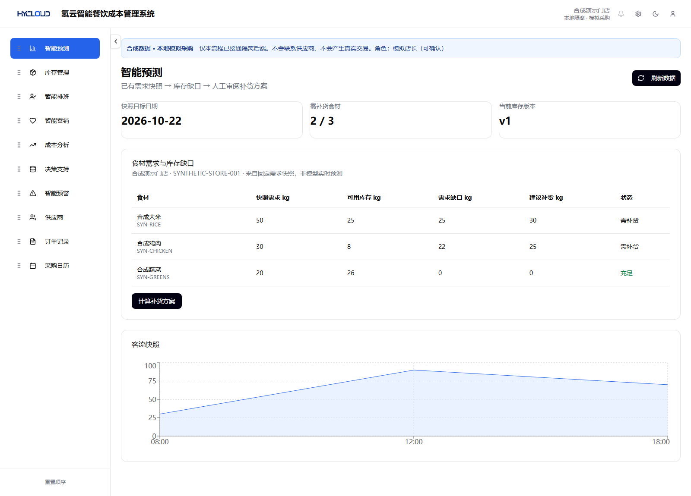
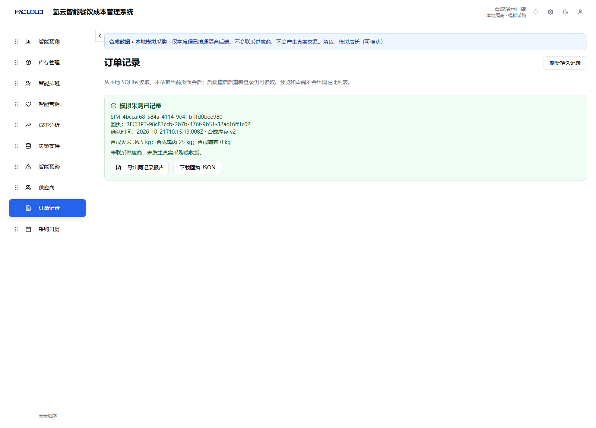

# IPDOS: Traceable Human-Confirmed Replenishment

The current revision demonstrates a bounded restaurant workflow: **demand snapshot → inventory gap → human-edited proposal → matching review → simulated order → persistent receipt and report**. It retains the restaurant navigation, tables and chart. New source: [`business-demo/`](business-demo/).

**Synthetic data and simulated procurement only.** No supplier connection, payment, real transaction, live forecasting model or production authentication is provided.

## Download and run — no build required

[**Download the prebuilt business demo**](https://github.com/Zane-0260907/ipdos-rule-replay/releases/download/v0.2.0-business-r2/ipdos-business-prebuilt-r1.zip) · [Release files](https://github.com/Zane-0260907/ipdos-rule-replay/releases/tag/v0.2.0-business-r2) · [**Watch the new business-flow video**](https://www.youtube.com/watch?v=6EFWHdpDLiw)

Requires **an existing Node.js 24 installation**. Verified with **Node 24.19.0 / Windows x64**. Node is **not bundled**. Other platforms and versions have not been validated.

1. Extract the entire ZIP to a writable folder.
2. Run `start.cmd`, or run `node reviewer-launcher.cjs` from that folder.
3. Open **http://127.0.0.1:3038/** and select the synthetic manager role.
4. Press **Ctrl+C** to stop. Records persist in that extracted copy's `data/simulation.sqlite`.

The ZIP includes built frontend files, compiled Nest backend and runtime dependencies. **No npm install, compiler, Vite server, PostgreSQL or Docker is needed to run it.** Only loopback ports 3037/3038 are used. Port conflicts produce a startup error; other applications are not stopped. For a fresh scenario, extract another copy of the original ZIP and preserve records you want to keep.

ZIP: **21,122,476 bytes**. SHA-256:

```text
65a4796410075577aa944540412e7f950c41e6b4b4a628a65b20795d15790415
```

## Business walkthrough

| Step | Observable result |
| --- | --- |
| Read 智能预测 / demand snapshot | Fixed rice demand 50 kg, stock 25 kg and suggestion 30 kg. The traffic chart is a fixed synthetic snapshot. |
| Calculate, edit and review | Save a 31.5 kg proposal and explicitly review that content. Preview/review creates no order. |
| Change stock during review | The synthetic button changes rice stock from 25 to 20 kg. Old confirmation returns HTTP 409, with zero orders. |
| Recalculate and review again | Suggestion becomes 35 kg. Edit to 36.5 kg, save, review that content, then confirm. |
| Read the simulated receipt | Local SQLite preserves the order, linked review, confirmed quantities and input revision. No supplier receives anything. |
| Retry, export and restart | The same request returns the same receipt. DOCX/JSON read the saved record. After restart, select a role again to read it. |





These are real screenshots of the isolated revision. Other restaurant navigation entries remain unconnected; their presence is not a claim of integrated functionality.

## Verification and limits

R2 passed **14 core checks and 12 real HTTP checks**, including stale input, content/review mismatch, permissions, durable retries, write failure/rollback, restart and report content. The layers overlap and are not field experiments. A separate fresh R2 dependency installation and both builds passed.

The exact prebuilt ZIP was extracted and run without dependency installation or compilation. Actual Chromium checks covered the workflow, matching DOCX/JSON downloads, process restart and viewer restrictions. See [runtime evidence](business-demo/verification/prebuilt-runtime-verification-r1.json) and [source correspondence](business-demo/SOURCE_PROVENANCE.json).

- Proposals bind the complete synthetic snapshot, inventory revision, policy values, selected rule-module fingerprints and quantities. Review binds immutable content and actor. Creating B does not globally revoke a review of A.
- Confirmation rechecks role, matching review/content, current input version and loaded rule binding. Calculation and registry modules are hashed on startup/module load; there is no live file monitor or whole-program fingerprint.
- SQLite transactions, uniqueness constraints and a durable actor/key/request-hash/order association provide bounded local retry handling. This does not prevent every similar purchase or establish unconditional/distributed exactly-once execution.
- The role selector is deliberately accessible. The viewer button's “只读” label is overbroad: viewer can calculate, edit and save proposals; it cannot review, confirm or change inventory.
- No Prophet/SHAP/Kalman algorithms, causal identification, forecasting accuracy, optimal scheduling, real-store A/B results or business gains are established. DOCX structure/content were checked; Word layout was not visually validated.

## Source, earlier version and license

The restaurant frontend is based on the owner's supplied restaurant project. Backend lineage includes [Juggle-ops/dietsystem](https://github.com/Juggle-ops/dietsystem), baseline `a52137f904f78eaebd546d9808503b26e3b10549`; its history remains here. This revision adds the isolated human-confirmed flow. [Developer instructions](business-demo/README.md) are optional; reviewers can use the ZIP.

The repository name preserves the earlier **rule-replay workbench**. Its original root files remain, its documentation is preserved in [README-rule-replay.md](README-rule-replay.md), and [commit 4e70bf6](https://github.com/Zane-0260907/ipdos-rule-replay/tree/4e70bf67abe48edf8045898b03f8e8f92bd24dd1) remains accessible. Its 28 tests and [older video](https://youtu.be/wjxquXh4LxQ) describe that older tool, not this business workflow.

Project code follows the existing [Apache-2.0 LICENSE](LICENSE); original copyright text is retained. Dependencies retain their own licenses. The ZIP preserves their supplied LICENSE/NOTICE files and includes frontend/backend license inventories.
