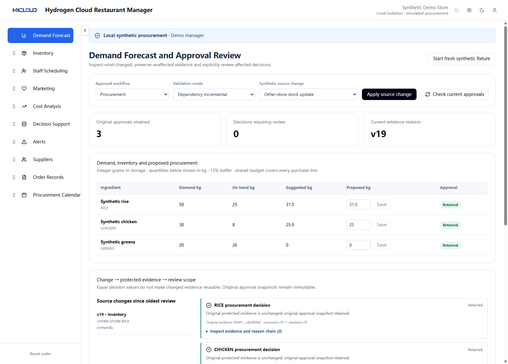
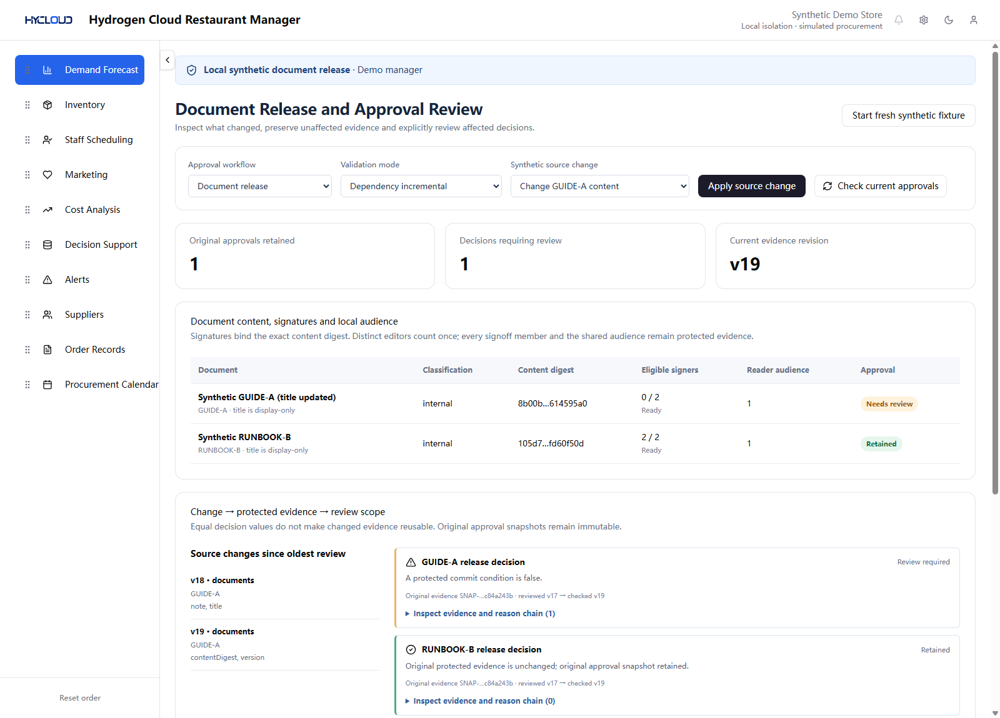

<div align="center">
<h1>IPDOS</h1>
<p><strong>Inspectable approvals across procurement and document release</strong></p>
<p>See what changed. Keep unaffected approvals. Review the decisions that need attention.</p>
<p><a href="https://github.com/Zane-0260907/ipdos-rule-replay/releases/download/v0.3.0/ipdos-v0.3.0-prebuilt.zip"><strong>Download &amp; run</strong></a> &middot; <a href="docs/DEMO.md"><strong>Illustrated walkthrough</strong></a> &middot; <a href="docs/README.md"><strong>Documentation</strong></a> &middot; <a href="#versions-and-recordings"><strong>Videos &amp; versions</strong></a> &middot; <a href="https://github.com/Zane-0260907/ipdos-rule-replay/releases/tag/v0.3.0"><strong>Release v0.3.0</strong></a></p>
</div>

IPDOS connects changing evidence to the decisions a person reviewed. **Two local workflows share one contract and commit service:** preserve unchanged approvals, explain affected ones, and explicitly review what changed.

## See the current application

### Procurement: keep unaffected approvals

Another store's stock changes; all three original approvals remain. Related stock and shared-budget changes show different review scopes.

[](docs/images/approval-workbench/01-unrelated-retained.png)

### Document release: bind review to current content

A changed document digest cannot use old-content signatures. The guide needs review while the unaffected runbook keeps its original approval. A shared audience change can affect both documents.

[](docs/images/approval-workbench/06-content-signatures.png)

These are complete, unmodified screenshots of the application with synthetic data. Click either image to inspect it at full resolution. [Browse all nine screenshots and reason chains](docs/SCREENSHOTS.md).

## Run the demo

1. [Download the runnable ZIP](https://github.com/Zane-0260907/ipdos-rule-replay/releases/download/v0.3.0/ipdos-v0.3.0-prebuilt.zip) and extract it to a writable folder.
2. With **Node.js 24.x** installed, run this command from that extracted folder:

   ```sh
   node server/run.cjs
   ```

3. Open **http://127.0.0.1:3338/** and choose the demo manager.

The API uses loopback port **3337**; the page uses **3338**. No npm installation, Docker or external database is needed by the prebuilt app. [Full quick start, source checkout and troubleshooting](docs/QUICKSTART.md).

## What to try

| Try this | What to inspect |
| --- | --- |
| Switch whole-revision and dependency modes after an unrelated change | Different review scope; preserved approval identities |
| Insert then delete a previously missing join key | Equal decision values still require review when protected evidence history changes |
| Reduce rice stock from 25 to 20 kg; save a 36.5 kg proposal | Stock reason chain, then shared-budget review scope |
| Change GUIDE-A content, refresh its synthetic signatures, then change the audience | Content binding, selected renewal and shared dependencies |
| Confirm once, change source state, then retry the saved request | The original receipt and authority chain; no second local effect |

Follow the [step-by-step walkthrough](docs/DEMO.md). The new v0.3.0 recording is awaiting upload; the [available recordings below](#versions-and-recordings) are clearly marked by version.

## Downloads and evidence

| You want to… | Download | Guide |
| --- | --- | --- |
| Run the current English app | [Prebuilt application](https://github.com/Zane-0260907/ipdos-rule-replay/releases/download/v0.3.0/ipdos-v0.3.0-prebuilt.zip) | [Quick start](docs/QUICKSTART.md) |
| Inspect or rebuild the current implementation | [Application source](https://github.com/Zane-0260907/ipdos-rule-replay/releases/download/v0.3.0/ipdos-v0.3.0-source.zip) | [Architecture and contracts](docs/ARCHITECTURE.md) |
| Inspect controlled-fixture results and raw records | [Regression evidence](https://github.com/Zane-0260907/ipdos-rule-replay/releases/download/v0.3.0/ipdos-v0.3.0-regression-public.zip) | [Evaluation](docs/EVALUATION.md) · [Reproduction](docs/REPRODUCING.md) |
| Replay the bounded public-source example | [Devguide replay, including synthetic case databases](https://github.com/Zane-0260907/ipdos-rule-replay/releases/download/v0.3.0/ipdos-v0.3.0-public-devguide-replay.zip) | [Frozen source contract](public-source-replay/PROTOCOL.md) · [Replay report](public-source-replay/REPORT.md) |

[SHA-256 checksums](https://github.com/Zane-0260907/ipdos-rule-replay/releases/download/v0.3.0/SHA256SUMS.txt) · [Publication verification](verification/v0.3.0/PUBLICATION_REVIEW.json) · [All release files](https://github.com/Zane-0260907/ipdos-rule-replay/releases/tag/v0.3.0)

The named source ZIP is the compact application package. GitHub's automatic “Source code” archives contain the whole repository, including historical projects.

## One contract and commit path

| Layer | Responsibility |
| --- | --- |
| Workflow adapters | Map procurement or document evidence into a finite declared contract |
| Evidence and review ledger | Preserve original snapshots, explain protected changes and append explicitly selected reviews |
| Commit transaction | Recheck evidence, rules, authority and request identity; atomically save a simulated effect and receipt |

[Architecture diagram and module map](docs/ARCHITECTURE.md) · [Approval contract](approval-workbench/study/CONTRACT.md) · [Document contract](approval-workbench/study/DOCUMENT_CONTRACT.md)

## Documentation

[**Open the documentation index**](docs/README.md)

- **Use it:** [Quick start](docs/QUICKSTART.md), [walkthrough](docs/DEMO.md), [screenshots](docs/SCREENSHOTS.md).
- **Understand it:** [Architecture](docs/ARCHITECTURE.md), [review semantics](approval-workbench/study/CONTRACT_IMPLEMENTATION_NOTES.md), [scope and limits](docs/LIMITS.md).
- **Verify it:** [Evaluation](docs/EVALUATION.md), [reproduction commands](docs/REPRODUCING.md), [release status](docs/RELEASE_STATUS.md), [public evidence provenance](reproducibility/approval-workbench/PUBLIC_EVIDENCE_DERIVATION.json).

## Versions and recordings

| Version | Interface and guide | Recording / download |
| --- | --- | --- |
| **Current: v0.3.0 approval workbench** | [Procurement + document workflows](docs/DEMO.md) | New video awaiting upload · [Runnable ZIP](https://github.com/Zane-0260907/ipdos-rule-replay/releases/download/v0.3.0/ipdos-v0.3.0-prebuilt.zip) |
| **Legacy: Business Flow R2** | [Original illustrated landing page](README-business-r2.md) · [source guide](business-demo/README.md) | [Watch the R2 video](https://www.youtube.com/watch?v=6EFWHdpDLiw) · [R2 downloads](https://github.com/Zane-0260907/ipdos-rule-replay/releases/tag/v0.2.0-business-r2) |
| **Legacy: initial rule replay** | [Original guide, screenshot and checks](README-rule-replay.md) | [Watch the rule-replay video](https://youtu.be/wjxquXh4LxQ) · [original mechanism](docs/MECHANISM_AND_RESULTS.md) |

Historical code, screenshots, evidence and tags remain available. The new prototype's 13% integer-gram calculation differs from the R2 10% formula and human edits; [the quantities have different derivations](approval-workbench/study/LEGACY_DIFFERENCES.md).

## Scope and license

All purchases, releases, actors and signoffs are **local simulations**. The role selector is demo access, not production authentication. The finite contract trusts its mediated fact writer and journal. The evidence covers controlled fixtures and a bounded source-contract replay; it does not measure real approvals, participant time, production failure rates or business gains. [Read the full limits and related-work boundaries](docs/LIMITS.md).

Project code retains [Apache-2.0](LICENSE), [upstream lineage](https://github.com/Juggle-ops/dietsystem), and the [recorded author credits](README-rule-replay.md#authors--maintainers). [Third-party legal texts](approval-workbench/THIRD_PARTY_LICENSES/INVENTORY.json) and [CC0 devguide attribution](public-source-replay/README.md) are retained.
