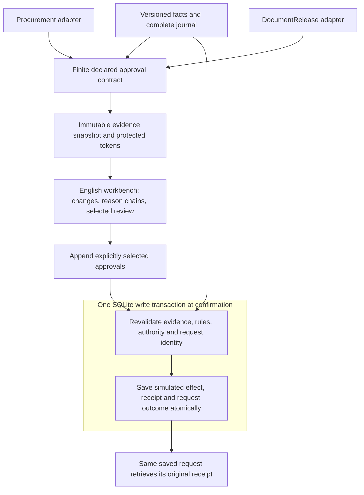

# Architecture and approval contract

[Documentation index](README.md) · [Walkthrough](DEMO.md) · [Scope and limits](LIMITS.md)

The two adapters share an interpreter, immutable review ledger and commit service. A preview explains possible review scope; authoritative admission is revalidated inside the commit transaction.

## Component map

| Component | Responsibility | Source |
| --- | --- | --- |
| Fact store | Mediated writes, field/row versions, durable journal, absence and membership history | [store.cjs](../approval-workbench/core/store.cjs) |
| Contract engine | Finite expressions, protected witnesses, impact scope and validation modes | [engine.cjs](../approval-workbench/core/engine.cjs), [predicate.cjs](../approval-workbench/core/predicate.cjs), [value.cjs](../approval-workbench/core/value.cjs) |
| Workflow definitions | Procurement quantities/budget and document content/signature/audience contracts | [contracts.cjs](../approval-workbench/core/contracts.cjs), [documents.cjs](../approval-workbench/core/documents.cjs) |
| Adapter boundary | Local procurement budget use or local document-release effect | [adapters.cjs](../approval-workbench/core/adapters.cjs) |
| Approval service | Sealed preview, selected review, current permission checks, commit uniqueness and receipt recovery | [service.cjs](../approval-workbench/core/service.cjs) |
| English workbench | Native controls, protected/display preview, differences and authority receipts | [ApprovalWorkbench.tsx](../approval-workbench/frontend/src/components/ApprovalWorkbench.tsx) |
| Local transport | Loopback HTTP endpoints and static frontend | [server/](../approval-workbench/server/) |

## What an approval binds

An approval preserves its original reviewed snapshot, decision value, protected evidence tokens, rule/engine identity and approval authority. The supported contract includes key reads, scans, joins and bounded integer aggregates. It tracks absence and predicate history, including changes that return to the same final value.

The preview makes the division visible:

| Workflow | Protected examples | Display-only examples |
| --- | --- | --- |
| Procurement | Proposed and suggested quantities, stock, reserve membership/reasons, prices, all shared-budget inputs, rule and grant versions | Ingredient names, notes and reason labels |
| Document release | Exact content digest, classification/readiness, signoff members, distinct eligible current-content signers, audience, policy and authority | Titles, notes and reader names |

Read the exact [approval contract](../approval-workbench/study/CONTRACT.md), [DocumentRelease contract](../approval-workbench/study/DOCUMENT_CONTRACT.md) and [implementation notes](../approval-workbench/study/CONTRACT_IMPLEMENTATION_NOTES.md). A workflow's declared protected view is the boundary of the claim; arbitrary external semantics are not inferred.

## Retention and explicit renewal

A retained approval keeps its original identity and evidence. A selected review appends a new approval from the sealed preview. Unselected valid approvals keep their identities. The API also permits explicit renewal of a selected already-valid clause; it does not silently prohibit that operation.

Shared scope is coupled. Changing a price, proposed quantity or other protected shared-budget input can require all dependent procurement clauses to be reviewed. A shared audience or authority change can likewise affect several document clauses. Zero purchase quantity does not automatically make a dependency irrelevant.

## Four modes, one contract

| Mode | Validation strategy |
| --- | --- |
| Whole revision binding | Conservatively binds the complete source revision |
| Row versions + predicate fences | Uses row/key versions with conservative table fences for scans |
| Full protected-view recomputation | Recomputes the complete declared decision/evidence view |
| Dependency incremental | Reuses unaffected declared work and validates affected dependencies |

All four are self-implemented comparators. The safe row mode is not a deliberately unsafe row-only baseline. Unknown or untracked logic must fail closed or use the declared conservative fallback.

## Confirmation and retry

The confirmation transaction rechecks the active draft, evidence, contract/rules, original approval authority and current caller permission before saving the effect. Receipt, local effect, request outcome and draft status share the transaction. Per-draft uniqueness also prevents a second effect using a different request key.

An authorized identical key/body retry retrieves its original saved receipt before applying the freshness checks for a new write. A changed body conflicts. These are local guarantees; they do not establish unrestricted exactly-once business execution, distributed correctness or deduplication across distinct drafts.

[Inspect the evaluation](EVALUATION.md) · [Reproduce the oracles](REPRODUCING.md) · [Read all boundaries](LIMITS.md)
