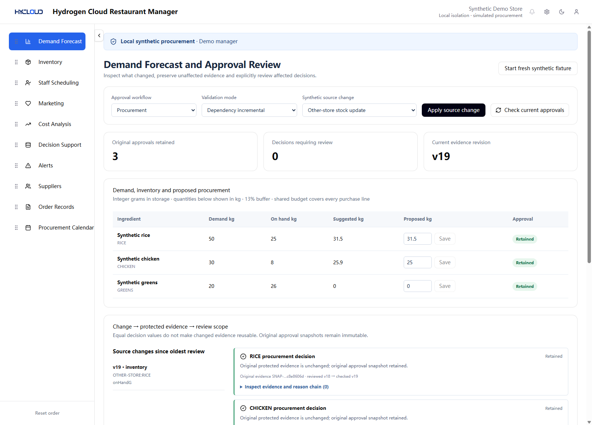
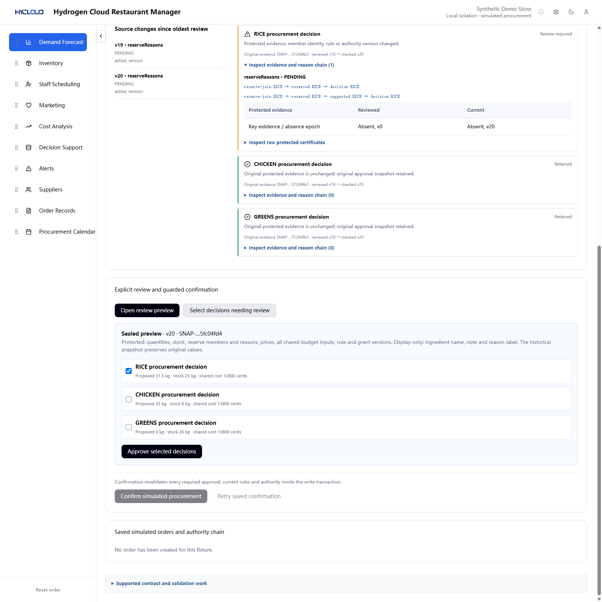
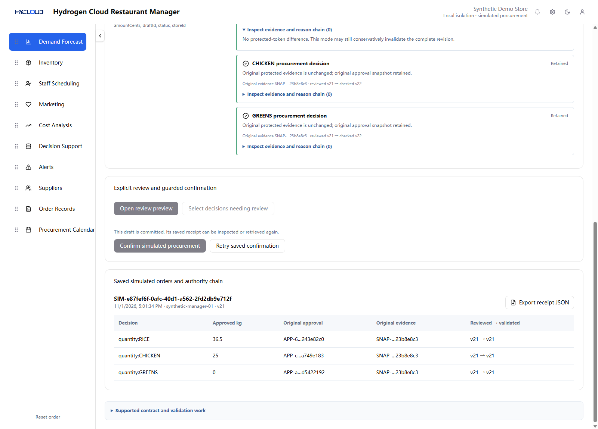
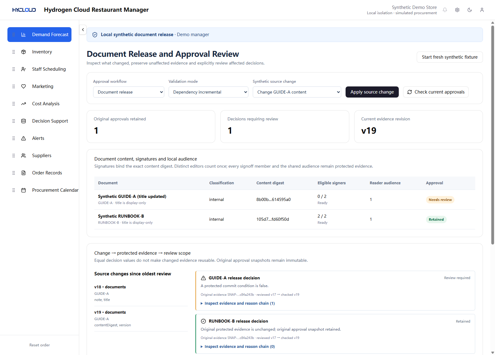

# Illustrated walkthrough

[Documentation index](README.md) · [Run the application](QUICKSTART.md) · [All screenshots](SCREENSHOTS.md)

## Recordings

**Current v0.3.0:** the new procurement/document workbench recording is awaiting upload. This guide and its screenshots describe the released application now.

Earlier recordings remain available, with their original scope:

- [Business Flow R2 video](https://www.youtube.com/watch?v=6EFWHdpDLiw): the earlier restaurant replenishment flow.
- [Initial rule-replay video](https://youtu.be/wjxquXh4LxQ): the earlier fixed-snapshot rule comparison tool.

Neither earlier recording demonstrates the current two-adapter approval contract.

## Start with a fresh procurement fixture

Run the [current app](QUICKSTART.md), select the demo manager, choose **Procurement** and press **Start fresh synthetic fixture**. The initial proposed quantities are 31.5 kg rice, 25 kg chicken and 0 kg greens. Storage uses integer grams; this prototype's buffer is 13%.

1. Open **Supported contract and validation work**. Read the protected scope and the finite supported operations.
2. Press **Open review preview**. The sealed preview distinguishes protected evidence from display-only values.
3. Press **Select decisions needing review**, inspect the three choices, then **Approve selected decisions**. No order is created by preview or review.

## Keep unaffected original approvals

Apply **Other-store stock update** in dependency-incremental mode. All three approvals remain attached to their original evidence. Inspect the original snapshot IDs and the current checked revision.

Switch to **Whole revision binding**. The same unrelated change conservatively requests review of all three decisions. Return to **Dependency incremental** to see the retained original approvals again. This compares four self-implemented modes under the same declared contract; it is not an unrestricted comparison with other published systems.

## Inspect equal output with changed protected history

Apply **Insert then delete a missing join key**. The final key is absent again and the complete rice decision projection is unchanged, but the persisted absence epoch has changed. Rice requires an explicit review; chicken and greens keep their original approvals.

Open a new preview, select the decisions needing review, and inspect rice's expanded reason chain. The preview selects rice only. Approve it; unselected approval identities remain unchanged.

The rule is evidence equality within the declared contract, not equality of the final purchase quantity alone.

## Follow related stock and shared-budget changes

1. Apply **Reduce rice stock by 5 kg**. On-hand rice falls from 25 to 20 kg. Expand its reason chain to compare the reviewed and current stock values.
2. Save **36.5** in the rice proposed-quantity field. All three clauses depend on the shared budget, so all three now need review.
3. Open a new preview, explicitly select and approve the affected decisions, then press **Confirm simulated procurement**.

[Inspect the stock reason](images/approval-workbench/03-stock-reason.png) · [Inspect the shared-budget review](images/approval-workbench/04-shared-budget.png)

The saved receipt links every decision to its original approval and snapshot. Apply another source change and choose **Retry saved confirmation**. The identical saved key/body returns the same receipt and creates no second local effect. The receipt can be exported as JSON.

## Reuse the mechanism for document release

1. Choose **Document release**, start a fresh fixture and approve both documents from a sealed preview.
2. Apply **Change a display-only title**. The protected approvals remain valid.
3. Apply **Change GUIDE-A content**. Its old signatures no longer match the new digest: eligible signers become **0 / 2**. RUNBOOK-B retains its original approval.
4. Apply **Re-sign current GUIDE-A content**. Open a new preview and explicitly renew the affected guide decision.
5. Apply **Change the shared reader audience**. Both clauses depend on that audience. Inspect the membership and new-principal reason chains, then review both current decisions.
6. Confirm a **simulated release** and inspect its saved authority chain.

[Audience reason chain](images/approval-workbench/07-audience-reason.png) · [Saved local release](images/approval-workbench/08-release-receipt.png)

## What the walkthrough establishes

The application makes declared evidence changes, selected renewal and saved local authority visible. All purchases, signatures, users and releases here are synthetic. It does not contact a supplier or publish a document. See the [scope and evidence limits](LIMITS.md), [architecture](ARCHITECTURE.md) and [independent reproduction instructions](REPRODUCING.md).
