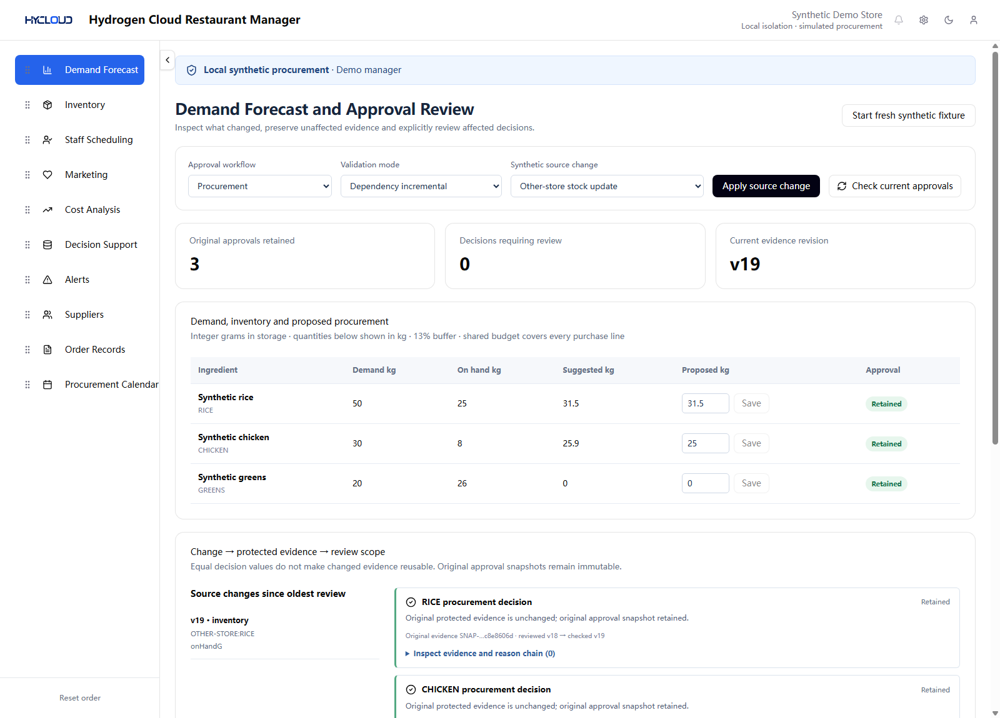
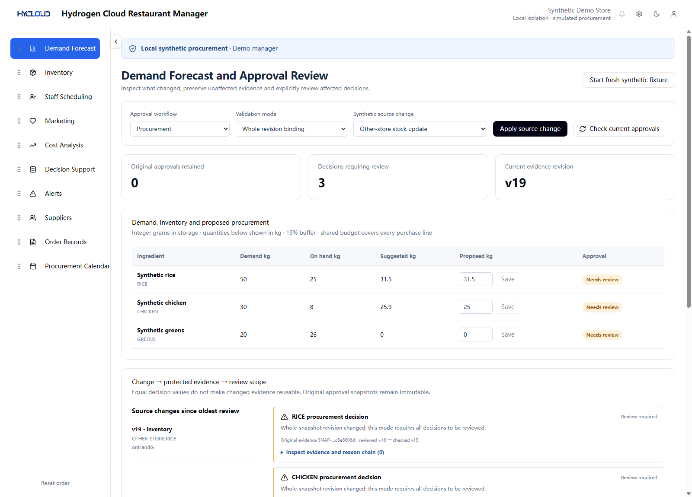
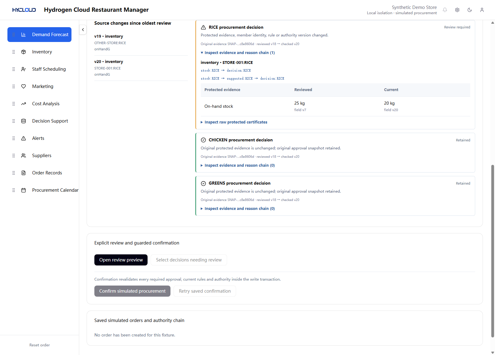
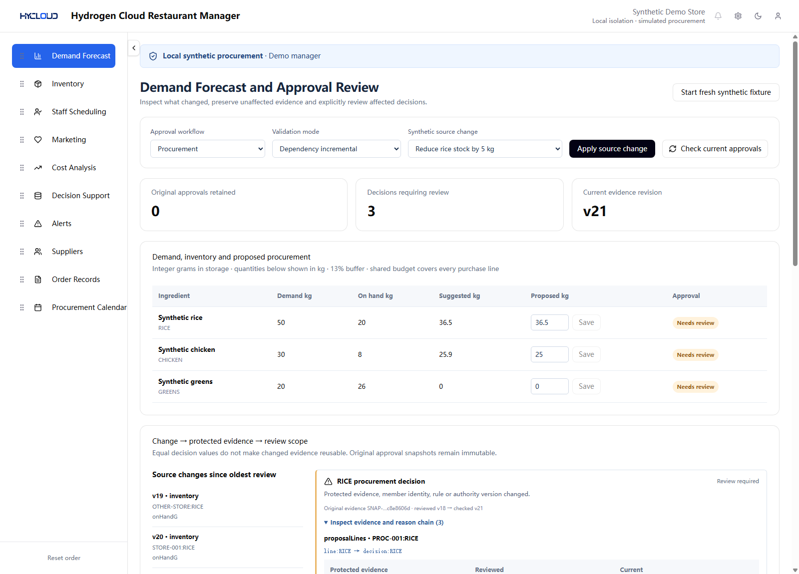
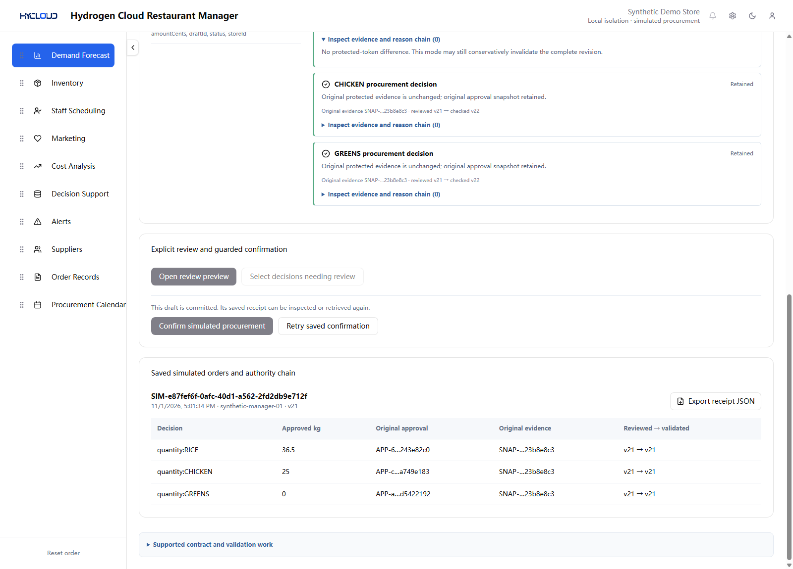
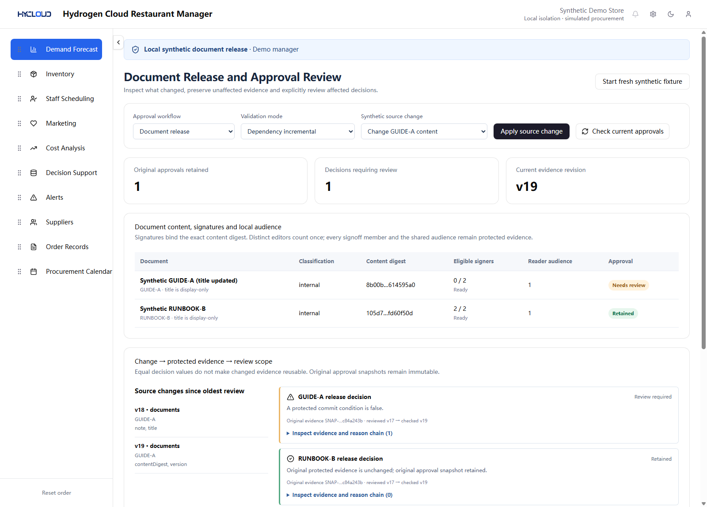
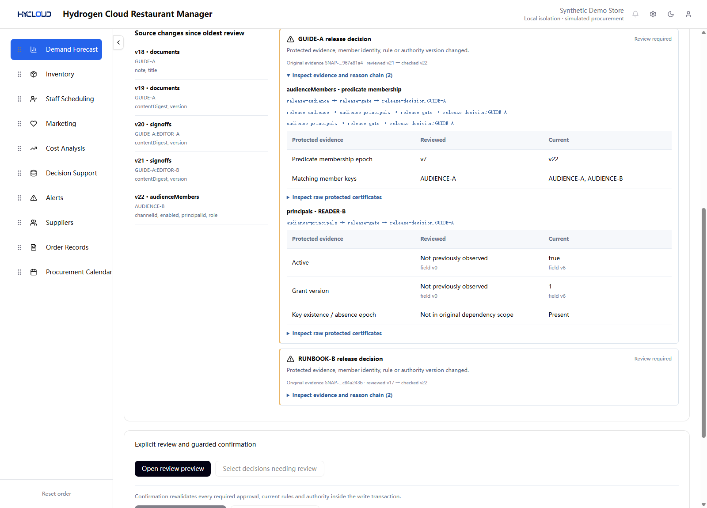
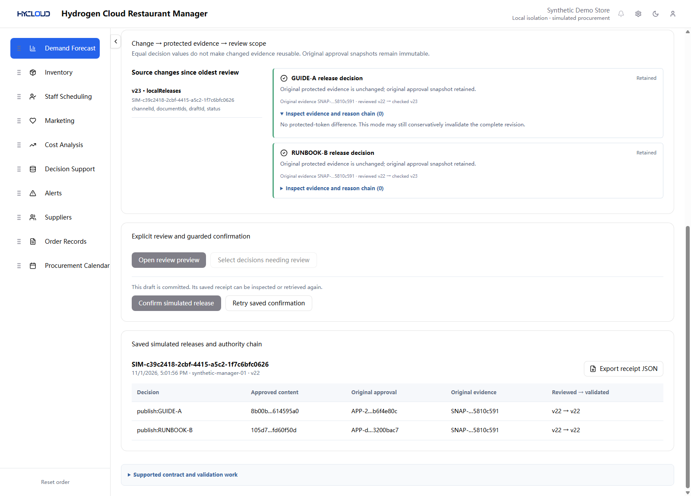
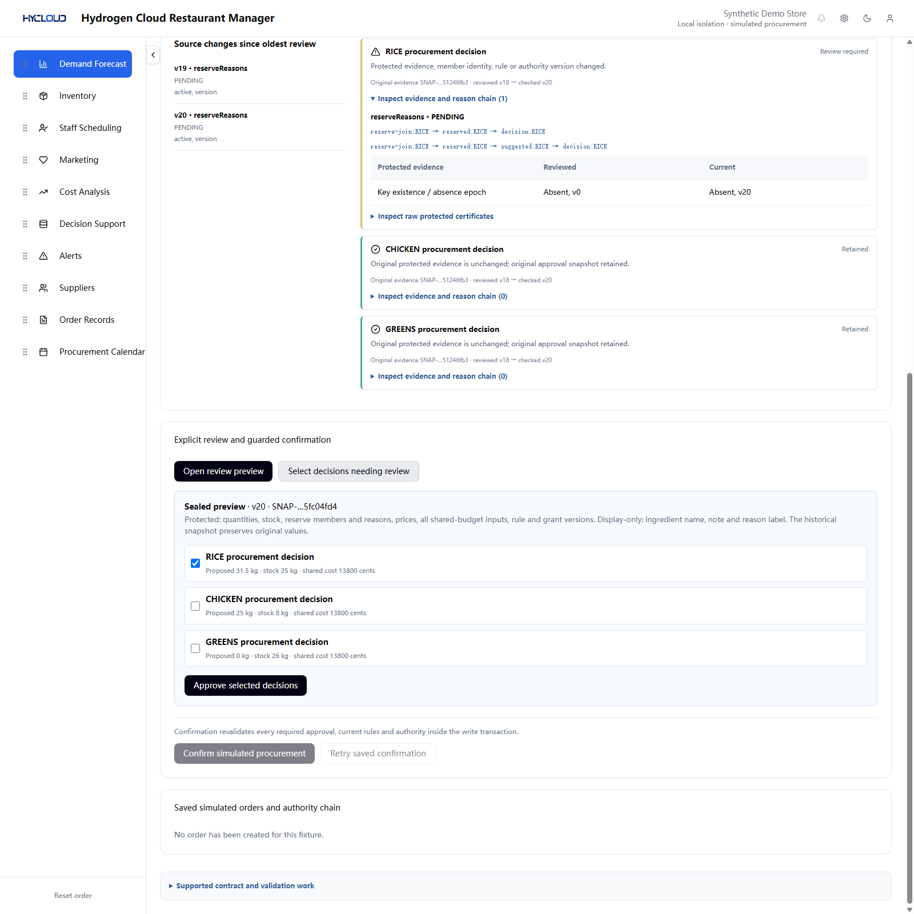

# Screenshot gallery

[Documentation index](README.md) · [Walkthrough](DEMO.md) · [Run the app](QUICKSTART.md)

These nine complete PNGs are byte-identical copies of the released English UI evidence. They use synthetic data and have no overlays, compositing or cropping. Open an image at full resolution to inspect small identifiers and evidence fields.

## Unrelated inventory update

All three original procurement approvals remain retained after another store changes its stock.

## Conservative whole-revision comparison

The same source revision change conservatively invalidates the complete review in whole mode.

## Relevant stock evidence

The rice reason chain compares reviewed stock of 25 kg with current stock of 20 kg; other approvals remain attached to their original evidence.

## Shared-budget scope

The saved 36.5 kg proposal changes shared budget evidence and requires review of every dependent purchase clause.

## Saved procurement authority

The simulated order receipt records original approvals, original snapshots and reviewed/validated revisions.

## Changed content and signatures

GUIDE-A has zero eligible current-content signers after its digest changes. The unaffected runbook retains its approval.

## Shared audience evidence

An inserted audience member and principal appear in the reason chain; both document clauses require review.

## Saved local release

The document adapter records a simulated release with the same authority-receipt mechanism.

## Equal output, different protected history

The missing join key is absent again, but its recorded absence epoch changed. The full decision projection is unchanged and rice-only review is explicit.

## Original evidence

The originals remain in the [public regression evidence](../reproducibility/approval-workbench/artifacts/) and its [derivation manifest](../reproducibility/approval-workbench/PUBLIC_EVIDENCE_DERIVATION.json). This gallery adds short navigation paths; it does not replace or modify recorded evidence.
